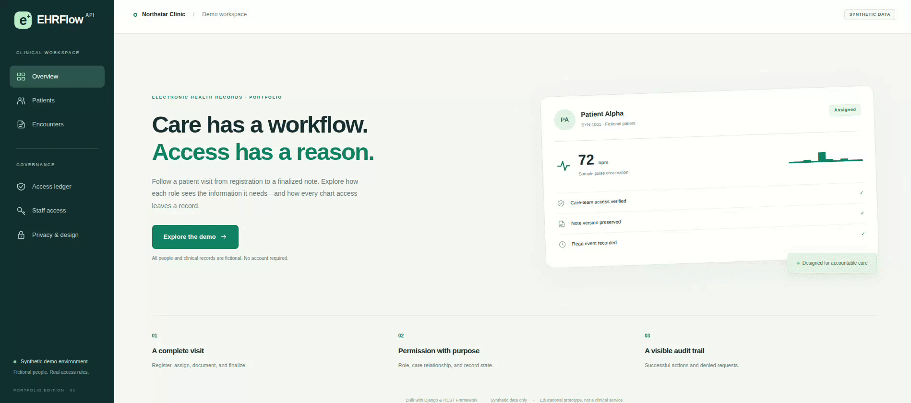

# EHRFlow API

**Electronic Health Records · Django REST API · Role-Based Access Control**

Follow a fictional patient visit from registration to clinical documentation and
access review. EHRFlow is a healthcare full-stack portfolio prototype with a
browser interface and an API that enforces staff permissions. All patients,
staff, and clinical scenarios are synthetic.



## Explore the demo

Click **Explore the demo** to create your own workspace with fictional patients,
encounters, care assignments, and six staff personas. No account or password is
needed. Switch personas to see how the same visit looks from different roles:

1. **Registrar:** register a patient, schedule a visit, and assign a care team.
2. **Nurse:** open an assigned encounter and record an observation.
3. **Clinician:** draft and finalize a note, then append a correction.
4. **Other clinician:** try an unrelated chart and see access denied.
5. **Privacy reviewer:** inspect the access ledger and denied requests.
6. **Access administrator:** manage staff roles and account access.

**Reset demo** starts a fresh workspace. The [full walkthrough](ehrflow/docs/usage.md#2-take-the-five-minute-tour)
explains each step.

## What the project demonstrates

| Area | Implementation |
| --- | --- |
| Backend engineering | Django REST Framework, relational models, validated requests, filtering, pagination, and migrations. |
| Authentication and authorization | Session and token authentication, CSRF protection, role-based permissions, care assignments, and workspace isolation. |
| Healthcare privacy | Task-specific access policies and minimum-necessary concepts, with their limits documented. |
| Data integrity | Transactional audit events, stale-edit version checks, finalized notes, and append-only corrections. |
| Frontend development | HTML, CSS, and JavaScript workflows for patient records, clinical documentation, staff administration, and access review. |
| Testing and operations | Integration tests for access denials and clinical workflows; database backup, restore verification, and expired-demo cleanup. |

**Stack:** Python 3.10 · Django · Django REST Framework · Djoser · django-filter · SQLite · Vanilla JavaScript · Pipenv

## Try it locally

With **Python 3.10** installed, run these commands from the repository root:

```bash
python -m pip install --user pipenv
pipenv sync
pipenv run migrate
pipenv run start
```

Use `python3.10` instead of `python` if that is your Python 3.10 command. Skip the
first command if Pipenv is already installed.

Open **http://localhost:8001/** and click **Explore the demo**. No database
download or `.env` setup is needed. Migrations create the local
`ehrflow/ehrflow.sqlite3` database; the demo creates the sample records when you
start exploring. Local databases and Python cache files are excluded from Git.

Stop with **Ctrl+C** and start again with `pipenv run start`. If you delete the
database, run `pipenv run migrate` before starting, then explore a new demo.
Starting the server alone does not create database tables or restore deleted data.

See the [setup and usage guide](ehrflow/docs/usage.md) for platform-specific
instructions, configuration, and maintenance.

## Verify and learn more

```bash
pipenv run test
pipenv run check
```

- [Architecture and role permissions](ehrflow/docs/architecture.md)
- [API examples, configuration, and maintenance](ehrflow/docs/usage.md)
- [Risk register and incident-response exercise](ehrflow/docs/risk-register.md)
- [Integration tests](ehrflow/records/tests/test_api.py)

## Scope and limitations

EHRFlow is a local portfolio prototype using fictional records, not a clinical
service or HIPAA-certified product. Persona switching is a demonstration
feature. Production deployment, dependency advisory review, and browser and
accessibility validation remain pending; see the risk register for details.
