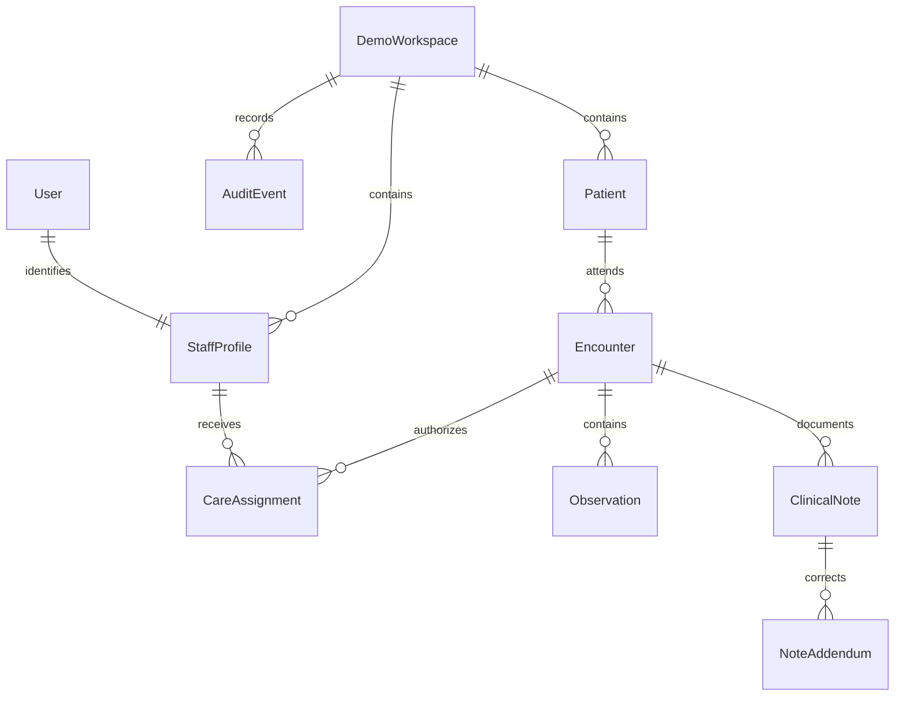

# EHRFlow: architecture and policy

## 1. Request flow

Browser → Django session/CSRF → DRF authentication → active workspace and staff profile → role and care-assignment checks → serializer validation → record transaction and audit → JSON response.

The browser calls same-origin APIs. Templates, CSS, JavaScript, and fonts are local. The backend is the authority for roles, data values, authorship, and versions. The user interface is an API client, not the access boundary.

## 2. Data relationships

A patient is not a login account. Staff roles do not come from patient data. Each encounter and note belongs to exactly one patient/workspace through its foreign keys. API mutations validate parent and staff references against the authenticated workspace before creating relationships.

## 3. Roles

| Role | Administrative patient data | Clinical content | Changes | Audit review |
| --- | --- | --- | --- | --- |
| Registrar | Workspace patients | None | Fixed demographics, scheduling, assignment | No |
| Nurse | Assigned patients | Assigned observations and finalized summary metadata | Fixed observations in open assigned encounters | No |
| Clinician | Assigned patients | Assigned encounters; own drafts and finalized notes | Own notes, finalization, addenda, observations, completion | No |
| Privacy reviewer | None through patient routes | None | None | Own workspace metadata |
| Access administrator | None through patient routes | None | Staff roles and activity | No |

Assignment checks include staff role, active flag, start/end time, and workspace. Changing a staff role or deactivating an account revokes assignments. Becoming active again does not restore assignments automatically. Staff and superuser flags provide no clinical bypass.

The demo owner can intentionally explore personas within their own server-side workspace session. The application does not treat this as a production identity mechanism. A standalone API token does not confer persona-switch rights.

## 4. Record integrity

Notes move from draft to finalized. Draft changes and finalization require the author and the current version. Finalized content has no edit or delete API. Addenda append a new authored record and increment the note version. Encounter completion requires a finalized note and no remaining drafts; completed encounters reject new notes/observations.

Database transactions use SQLite's IMMEDIATE mode. This serializes writers and avoids read-to-write lock upgrades for the critical flows. Version checks make stale clients receive `409`. This has been tested for sequential stale requests; high-contention production behavior has not been benchmarked.

## 5. Audit boundary

Read, change, denial, and role-switch events include actor metadata, resource reference, action, outcome, timestamp, and an independent request ID. The audit does not copy request bodies, note content, tokens, or raw search text. Development request logs redact query strings.

Mutations write their success event in the same transaction. A denial event is written by the exception handler after that transaction has rolled back. Clinical reads return `503` if their required audit event cannot be persisted. A storage outage can also prevent a denial from being recorded; the response fails closed and a content-free operational error is logged.

Successful audit-list reads also create review events. No audit modification route exists. An operator with SQLite or server access remains able to alter the database; append-only API behavior is not tamper-proof storage.

## 6. Classification and legal context

All records are invented. The prototype treats demographics, clinical content, and patient-linked audit metadata as distinct access categories to demonstrate purpose-based handling. This classification is a project policy, not an official HIPAA tier system.

The UI's privacy page explains that HIPAA's minimum necessary standard has treatment-related exceptions and links to official HHS guidance. Clinical assignments are this project's chosen authorization mechanism, not a representation of every healthcare organization's policy. Patient access/amendment procedures and special record categories are not implemented here.
